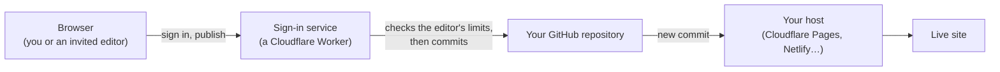

<p align="center">
  <a href="https://kilncms.com"></a>
</p>

<h1 align="center">Kiln</h1>

<p align="center">
  <strong>Edit your website by clicking the text on the page and typing.</strong><br>
  An open-source, click-to-edit CMS for static sites. Every publish is a commit to your own GitHub repository.
</p>

<p align="center">
  <a href="LICENSE"></a>
  <a href="https://github.com/kilncms/kiln/actions/workflows/ci.yml"></a>
  <a href="CONTRIBUTING.md"></a>
</p>

<p align="center">
  <a href="https://kilncms.com">Website</a> ·
  <a href="https://demo.kilncms.com">Demo</a> ·
  <a href="https://kilncms.com/docs">Docs</a> ·
  <a href="CHANGELOG.md">Changelog</a>
</p>

<p align="center">
  <a href="https://kilncms.com"></a>
</p>

Kiln makes a static website editable in place. The site's owner marks which parts of
their HTML pages can change; they and the people they invite then open the live site,
click the words or pictures, change them, and press **Publish**. Each publish saves
plain files to the owner's own GitHub repository, and the site's host puts the new
version live. There is no database to run, and a plain HTML site needs no build step.

Kiln is for people who build sites for clients and want the client to change their own
opening hours, for people whose site was made with an AI tool such as Lovable, v0 or
Bolt, and for people leaving WordPress, Squarespace or Wix for plain files they own.

## Contents

- [Try it in a minute](#try-it-in-a-minute)
- [How it works](#how-it-works)
- [Features](#features)
- [Quick start](#quick-start)
- [Marking a page as editable](#marking-a-page-as-editable)
- [The command-line tool](#the-command-line-tool)
- [Plans](#plans)
- [Security model](#security-model)
- [Documentation](#documentation)
- [Limitations](#limitations)
- [Development](#development)
- [Licence](#licence)

## Try it in a minute

<a href="https://demo.kilncms.com"></a>

Open the live demo at **[demo.kilncms.com](https://demo.kilncms.com)**, click a word
that has a dashed outline, type, and publish. The recording above is one edit on that
demo, from click to saved version.

The home page of **[kilncms.com](https://kilncms.com)** is itself a Kiln site: the
**Edit this page** link at the bottom opens the same editor on the page that describes it.

## How it works

1. **Mark what can change.** Add a few HTML attributes to your pages (by hand, with
   `kiln tag`, by clicking in the browser, or by giving [KILN_PROMPT.md](KILN_PROMPT.md)
   to the AI that built the site), plus two script tags.
2. **Sign in at `yoursite.com/kiln`.** The owner signs in with GitHub. Invited editors
   sign in with Google and need no GitHub account.
3. **Click and type.** A round Kiln button appears in the corner. Every outlined part of
   the page can be clicked and changed where it stands.
4. **Publish.** A sheet shows each change before and after. Publishing saves the edited
   files to your GitHub repository as one commit, with the editor's name on it.
5. **Your host puts it live.** Cloudflare Pages, Netlify, Vercel or GitHub Pages sees the
   new commit and redeploys, usually in under a minute.



Visitors to the site load one small script (about 3 KB compressed) and nothing else.
The editor itself loads only after someone signs in. On a plain HTML site Kiln edits the
page's own HTML at the exact place that changed, so the rest of your hand-written
formatting is left as it was and each commit's diff is small.

<details>
<summary>The pieces, and what each one costs</summary>

| Piece | What it is | Size or cost |
|---|---|---|
| `kiln.js` | The script every visitor loads | about 7 KB, 3 KB compressed |
| `kiln-features.js` | Galleries, filters and calendars for visitors, loaded only on pages that use them | about 16 KB, 5 KB compressed |
| `kiln-editor.js` | The editor, loaded only after sign-in | about 710 KB, 225 KB compressed |
| Sign-in service (`kiln-auth`) | A Cloudflare Worker: GitHub and Google sign-in, and the commit pipeline every invited editor's change goes through | Cloudflare's free Workers plan for a few editors (see [self-hosting](docs/self-hosting.md)) |
| Your repository | The content, with every earlier version | free |
| Your host | Serves the site; Cloudflare Pages also runs the members area | free on Cloudflare Pages or GitHub Pages |

</details>

## Features

Editors change the words and the pictures. The layout, the fonts and the colours stay
the way the site was built.

### Editing

- **Words:** bold, italic, links and lists, and a Style menu that offers the site's own
  CSS classes, so text stays in the site's design.
- **Pictures:** replace one by uploading (it is made web-sized) or by picking one the
  site already has, describe it, and set its size. The full-size original is kept.
- **Documents:** add a PDF or another file to a text as a link, a chip or a card.
- **Repeating blocks:** duplicate, reorder and remove cards, list items and table rows.
- **Site-wide tools:** the site menu on every page in one commit, find and replace
  across the site, page titles, descriptions and social pictures, and a search that
  jumps to any page, field or tool.
- **Sections and theme:** add sections from a library of blocks kept in the repository,
  and change the colours and fonts the stylesheet already names.
- **On a phone:** the same editor, laid out for a thumb.
- **Keyboard and screen reader:** every editable part is in the Tab order, Enter opens
  it and Esc leaves it, toolbars and buttons have names, and each dialog is named by its
  heading and holds the keyboard while it is open. The first-visit guide is read out to a
  screen reader. None of what the editor adds for this is published.
- **AI writing helper** (optional, self-hosted only, with your own Anthropic key):
  shorten, reword or translate a field, or describe a picture, with a before and after.

### Publishing and history

- **Check, then publish:** every change waits on the page until Publish, which shows
  each one before and after and lets you drop any of them. A note becomes the commit
  message.
- **Undo:** for ten seconds after publishing, Undo takes that publish back as one more
  commit. Ctrl+Z or ⌘Z undoes any change not yet published.
- **Drafts and schedules:** save a change privately, or publish it at a chosen time.
- **History:** every version of a page, in plain words, reaching back to the first. Any
  version can be previewed on the page and brought back, for the whole page or one
  section, and a publish can be given a name.
- **Edits made at the same time:** when two people change the same part, Kiln warns and
  keeps both versions.

### People and access

- **Invite by Google email**, with no GitHub account needed, for 1 to 360 days or with no
  end date. Removing someone ends their access at once.
- **Choose what each person can change:** whole site, some pages, or some parts of a
  page, and which tools they get (drafts, History, new posts, scheduling, the menu, find
  and replace, comments, the AI helper, blocks, theme).
- **Suggest-only editors** propose changes that you approve or decline, and with one
  setting your host can build a preview of each suggestion first.
- **Reviewers** can leave comments pinned to any part of the live page and change nothing.
- **Who else is here:** editors see who else is signed in, and on which page.
- **Members area:** pages and files under `/members/` that only signed-in members can
  open, on Cloudflare Pages.

### Content types

- **Lists** with tags: tag any block, and visitors get filter buttons above the list.
- **Photo galleries** with captions and a full-screen viewer for visitors.
- **Events** that visitors can also see as a month, week or day calendar.
- **Blog posts and new pages** from templates kept in the repository, added to the blog
  index in the same commit, with no build step.

### For developers

- **Astro, in source mode:** on an Astro site Kiln saves the Markdown and MDX content
  files the pages are built from: text with its formatting, titles, dates, pictures,
  links and whole entries. See [source mode](docs/source-mode.md).
- **An API** that reads a page's editable parts as JSON and writes changes back as a
  checked commit with a name on it, with tokens limited by page, part and expiry.
- **An MCP server**, [`kiln-mcp`](mcp/README.md), so an AI assistant can edit the site
  through that API and nothing else.
- **Rescue from a website builder:** `rescue` copies a live Squarespace, Wix or
  WordPress site into plain HTML files, with a report of what did not come across.
- **Freeze an AI-built React app:** `rescue --render` turns a Lovable, v0 or Bolt app
  into plain HTML pages you can edit.

The full list, tool by tool, is in [what editors can do](docs/what-editors-can-do.md) and
on [kilncms.com/docs](https://kilncms.com/docs).

## Quick start

Each path needs your site in a GitHub repository, connected to a host that redeploys
on every commit (Cloudflare Pages is free and allows business sites), plus Node 20 or
newer and git.

The setup tool is run straight from this repository with `npx github:kilncms/kiln#release`.
It is not on npm yet. Not `npx create-kiln`: that name on npm belongs to an unrelated
project.

### Kiln Cloud: we run the sign-in service

About 15 to 25 minutes if the site already deploys from GitHub, and 7 days free with no
card. The full version is [the six steps on kilncms.com](https://kilncms.com/get-started).

1. In your site's folder, run the setup tool and press Enter to choose Kiln Cloud:
   ```bash
   npx github:kilncms/kiln#release
   ```
   It copies the editor files into `assets/`, writes `assets/kiln-config.js`, adds a
   `kiln.html` sign-in page, and offers to add the two script tags, to mark a first pass
   of what can be edited, and to commit and push.
2. Install the [Kiln GitHub App](https://github.com/apps/kiln-cms) on that repository
   only (**Only select repositories**).
3. Sign in at [app.kilncms.com](https://app.kilncms.com) with GitHub and add the site:
   its repository and its live address. The trial starts then.
4. Open `yoursite.com/kiln`, sign in with GitHub, click something and publish.

### Run it yourself: free, on your own accounts

About 30 to 45 minutes the first time, for someone at home in a terminal. You need a
Cloudflare account (the free plan is enough for a few editors).

1. In your site's folder, run the setup tool and choose to run it yourself:
   ```bash
   npx github:kilncms/kiln#release
   ```
   It deploys the sign-in service to your Cloudflare account, creates its storage, and
   wires the site's config to it.
2. If the setup tool has not taken you there, open `https://<your-worker>.workers.dev/setup`
   and press the button. It registers your
   own GitHub App, and the service keeps its credentials: you never copy a secret. Then
   install the app on your site's repository.
3. To invite editors or members, add [Google sign-in](docs/google-sign-in.md) (two
   secrets, about five minutes).
4. Check the setup, then open `yoursite.com/kiln` and sign in:
   ```bash
   npx github:kilncms/kiln#release doctor
   ```

<details>
<summary>Deploying the sign-in service by hand instead</summary>

```bash
git clone https://github.com/kilncms/kiln && cd kiln
npm install
cd worker
npx wrangler kv namespace create KILN            # prints an id
cp wrangler.example.toml wrangler.self.toml      # your own config; git ignores it
#   in wrangler.self.toml set: name, the KV id, ALLOWED_ORIGINS (your site's address)
npx wrangler deploy --config wrangler.self.toml
```

`worker/wrangler.example.toml` is a complete configuration for your own account, with
the three values to change marked. (`worker/wrangler.toml` is the maintainers' file; its
top level holds placeholders and cannot be deployed.) Then build the editor with
`npm run build`, copy `dist/kiln.js`, `dist/kiln-editor.js` and `dist/kiln-features.js`
into your site's `/assets/`, and add a `kiln.html` sign-in page at the site root. The
whole walkthrough is in [self-hosting.md](docs/self-hosting.md).

</details>

### Fully managed: we set it up and host it

For people who want to touch no code. Start the free trial on
[kilncms.com/pricing](https://kilncms.com/pricing): you need a free GitHub account, and
we help you make one.

### Start a new site from a template

```bash
npx github:kilncms/kiln#release new my-site
cd my-site
npx github:kilncms/kiln#release
```

`new` copies a template (the demo site, unless `--from owner/repo` names another), gives
it a fresh git history and a README that says what to change first. The second command
sets Kiln up for it.

### Move an existing site in

From Squarespace, Wix or WordPress, copy the live pages into plain files you own:

```bash
npx github:kilncms/kiln#release rescue https://your-site.com
```

From an AI-built React app (Lovable, v0, Bolt), freeze it into plain HTML once:

```bash
npm install playwright-core            # small, downloads no browser
npx github:kilncms/kiln#release rescue https://your-site.lovable.app --render --menu-shim
```

Both write a folder ready to push, with a `RESCUE-REPORT.md`.
Forms, shops, sign-ins and anything else that needed the old server or the app's own
scripts do not come across, and the report lists each one. Details in
[the command-line tool guide](docs/cli.md#copying-a-site-out-of-a-website-builder).

## Marking a page as editable

Kiln reads plain HTML attributes. Nothing else in the page has to change.

```html
<!-- Formatted text: bold, italic, links and lists when edited -->
<h1 data-cms="hero_headline">Welcome</h1>

<!-- Plain text only: emails, phone numbers, prices -->
<span data-cms="contact_email" data-cms-plain>hi@example.com</span>

<!-- A picture that can be replaced -->


<!-- A link whose words and address can both change -->
<a data-cms="cta" href="/contact.html">Get in touch</a>

<!-- Blocks that can be duplicated, reordered and removed -->
<div class="card-grid" data-cms-repeat="services">
  <div class="card">
    <h3 data-cms="card_title">Service A</h3>
    <p data-cms="card_desc">Description…</p>
  </div>
</div>
```

Then two script tags at the end of `<body>` on every page, and a small config file that
the setup tool writes for you:

```html
<script src="/assets/kiln-config.js"></script>
<script src="/assets/kiln.js" defer></script>
```

```js
// /assets/kiln-config.js
window.KILN = {
  repo:   'you/your-site-repo',
  branch: 'main',
  worker: 'https://kiln-auth.you.workers.dev',
  styles: [],
};
```

There are three ways to add the attributes: `npx github:kilncms/kiln#release tag` makes a
careful first pass you can review with `git diff`; **Make text/images editable** in the
editor lets you click the parts after you sign in; or paste
[KILN_PROMPT.md](KILN_PROMPT.md) into the AI that built the site. That file is also the
full reference: menus, shared headers and footers, galleries, events, blog templates, new
pages and the members area.

## The command-line tool

Run it in your site's folder as `npx github:kilncms/kiln#release [command]`. `--help`
lists every command and option; given with a command too, nothing is run and nothing is changed.

| Command | What it does |
|---|---|
| (none) | Sets Kiln up for the site in this folder: asks a few questions, copies the editor in, adds it to your pages, offers to commit |
| `doctor` | Checks a set-up site and says what is wrong |
| `update` | Copies the current editor into the site, and the members gate if the site has one |
| `update --worker` | Self-hosted only: brings your sign-in service up to date and offers to deploy it |
| `tag` | Marks headings, text and images editable, as a first pass (`--dry` shows what would change) |
| `add-site` | Adds this site to Kiln Cloud |
| `new [dir]` | Starts a new site from a template |
| `rescue <url>` | Copies a site out of a website builder into plain HTML (`--render` for a site drawn by JavaScript, `--try` to try editing it on this computer) |

More on each command, the limits of `rescue`, and what freezing an app costs:
[docs/cli.md](docs/cli.md).

## Plans

The editor is the same on all three. On all three your site's files stay in a GitHub
account you own, and you can move between them later.

| | Run it yourself | Kiln Cloud | Fully managed |
|---|---|---|---|
| **Price** | $0, open source | $4.99 a month per site | $14.99 a month per site |
| **Who runs what** | You run the sign-in service on your own Cloudflare account, with your own GitHub App | We run the sign-in service, the GitHub App and Google sign-in for your editors | We set your existing site up on Kiln and host it |
| **Your part** | About 30 to 45 minutes the first time, for developers at home in a terminal | One command in your site's folder, about 15 to 25 minutes | You touch no code; you need a free GitHub account |
| **Included** | Every feature, including the AI writing helper with your own Anthropic key | Editors, members, drafts, History, scheduling, comments and suggestions (not the AI writing helper) | Everything in Kiln Cloud, email forwarding on your domain if it has no email yet, and your support requests answered first |
| **Trial** | | 7 days free, no card | 7 days free, no card |

Plans are per site, not per person: add as many editors and members as the site needs.
Concierge setup, where we mark every part of the site by hand and set up each editor's
access with you, is $399 once on any plan. Billing is handled by Lemon Squeezy; prices and
billing questions are on [kilncms.com/pricing](https://kilncms.com/pricing).

**When a plan ends**, the editor stops working on the site, and so do its API tokens,
any changes scheduled to publish later, and signing in to a members area. The site, its
files and everything already published stay as they are, in your repository.

**You can leave at any time.** Your content is plain HTML in your own repository already.
Delete Kiln's two script tags and the site keeps working, with every edit still in it.
Galleries, filters and calendars become plain lists, and a members area needs replacing.
[Leaving](docs/for-site-owners.md#leaving) and [deleting what Kiln keeps](docs/deleting-data.md)
have the details.

## Security model

- **The owner** signs in with GitHub through a GitHub App installed only on the
  repositories they choose. The GitHub token stays in the sign-in service's storage and
  is never handed to the browser, which holds a session id. Every call the owner's editor
  makes goes through the service, bound to that one repository and site.
- **Invited editors** sign in with Google and never hold GitHub credentials. Every change
  they make goes through the sign-in service, which commits only to that one repository
  and only what that person was given:
  - **pages:** only the pages they were given, never `CNAME`, `_redirects`, `.github/` or
    `functions/`, and nothing is deleted;
  - **parts of a page:** an editor limited to some parts has every save compared with the
    page as it is, and a change outside those parts is refused with the part's name. Such
    an editor cannot add pages or change page settings, the menu or the theme;
  - **tools:** drafts, scheduling, new posts and the rest only when granted, and
    suggest-only and comment-only seats cannot publish;
  - **no scripts:** an editor's HTML may add no script, event handler or framing the page
    did not already have, and uploads are limited to pictures, PDFs, Office documents,
    fonts, audio and video, each under 15 MB and checked by its first bytes. SVG and XML
    files are refused.
- **API tokens** are made by the owner, limited by page, part and expiry, and pass the
  same checks as an invited editor.
- **Members pages** are checked at the edge with a signed, HttpOnly, Secure cookie and sent
  `private, no-store`.
- Formatted text is cleaned with DOMPurify before it is saved; plain-text fields are saved
  as plain text.

Kiln Cloud holds the access key GitHub gives its app for your repository, as any hosted
editor must. Run it yourself and only you hold it.

To report a security problem, please do not open a public issue: use **Report a
vulnerability** on this repository's [Security tab](https://github.com/kilncms/kiln/security),
or write to info@kilncms.com. [SECURITY.md](SECURITY.md) lists what matters most.

## Documentation

| Guide | For |
|---|---|
| [For site owners](docs/for-site-owners.md) | Running a Kiln site: marking parts, inviting people, publishing, members, updates and leaving |
| [For editors](docs/for-editors.md) | Send this to someone you invited to edit |
| [For members](docs/for-members.md) | Send this to someone you gave members access |
| [What editors can do](docs/what-editors-can-do.md) | Every editing tool, blog posts, and the API |
| [Self-hosting](docs/self-hosting.md) | Running the sign-in service on your own accounts, and one service for many sites |
| [Google sign-in](docs/google-sign-in.md) | The one-time Google setup a self-hosted service needs for editors and members |
| [Members area](docs/members-area.md) | Pages and files only signed-in members can open |
| [Source mode](docs/source-mode.md) | Editing an Astro site's content files, and what is not done yet |
| [The command-line tool](docs/cli.md) | Every command, `rescue`, and freezing an AI-built app |
| [KILN_PROMPT.md](KILN_PROMPT.md) | The full attribute reference, written so an AI can make a site Kiln-ready |
| [kiln-mcp](mcp/README.md) | Letting an AI assistant edit the site safely |
| [@kilncms/astro](integrations/astro/) | The Astro helper for source mode |
| [Deleting what Kiln keeps](docs/deleting-data.md) | Where data lives and how each part is removed |
| [Feature inventory](docs/FEATURE-INVENTORY.md) | Everything Kiln has, by part |
| [kilncms.com/docs](https://kilncms.com/docs) | Every tool, with pictures |
| [kilncms.com/how-it-works](https://kilncms.com/how-it-works) | Which sites work, and who runs what |
| [kilncms.com/api](https://kilncms.com/api) | The API, for scripts and AI assistants |

## Limitations

- **Static sites only.** Your host must redeploy when the repository changes, and a
  publish takes about a minute to go live (that is the host's deploy, not Kiln).
- **Astro is the only generator Kiln edits.** On Eleventy, Hugo and Jekyll it can't edit
  the content files yet, and refuses to edit their built pages, which the next build would
  erase.
- **An app that stays an app is not supported.** A React, Next.js, Vue or Svelte app has to
  be frozen into plain HTML first, and a site visitors must sign in to see does not work.
- **One configuration edits one repository.** A monorepo works through the `root` setting.
- **Editors and members need a Google account**, since that is how they sign in.
- **Uploads are not tidied.** Pictures already in the repository can be picked again, but
  nothing lists unused uploads or removes them.
- **Renaming a page means making a new one.** There is no change of address with a
  redirect.
- **The first-pass tagger skips tables.** Mark those by hand or in the browser.
- **The members area needs Cloudflare Pages**, because its gate is a Pages Function.
- **The AI writing helper is self-hosted only**, with your own Anthropic key.

## Development

```bash
git clone https://github.com/kilncms/kiln && cd kiln
npm install
npm test          # every suite: engine, worker, CLI, source mode, release (node --test)
npm run build     # dist/kiln.js, dist/kiln-editor.js, dist/kiln-features.js
node scripts/check-links.mjs                       # every link in the Markdown points somewhere
node scripts/ui-check.mjs http://localhost:8774/   # browser check of the editor on a local site (needs Playwright, see the file)
npm run dev       # the sign-in service locally, on port 8787
```

<details>
<summary>Repository layout</summary>

```
src/engine.js        the splice engine (parse5 offsets, batch edits, attribute edits)
src/file-policy.js   which file types an invited editor may write (shared by worker and editor)
src/github.js        transports (direct and through the worker), conflict retries, atomic commits
src/autotag.js       the first-pass tagger behind `kiln tag`
src/kiln.js          the script every visitor loads
src/features.js      galleries, tag filters and the event calendar for visitors
src/editor/          the editor
cli/                 the setup tool: wizard, doctor, update, tag, new, rescue
worker/              the kiln-auth Cloudflare Worker (sign-in and the commit pipeline)
templates/           members-area files and headers the setup tool copies into a site
integrations/astro/  the Astro helper for source mode
mcp/                 kiln-mcp
test/                every suite
scripts/             build, release, propagate, backup and restore, end-to-end, link check
```

</details>

How the development, staging and live environments fit together, and how a change is
released, is in [ENVIRONMENTS.md](ENVIRONMENTS.md). How to contribute is in
[CONTRIBUTING.md](CONTRIBUTING.md).

## Licence

Kiln is open source under the [GNU AGPL-3.0](LICENSE): free to use, run yourself, change
and build on, including for commercial and client work. If you run a changed version of
Kiln as a public network service, the AGPL asks you to make your changes available to its
users.

Kiln is built and run by Wilder Idea LLC. Questions: info@kilncms.com.
